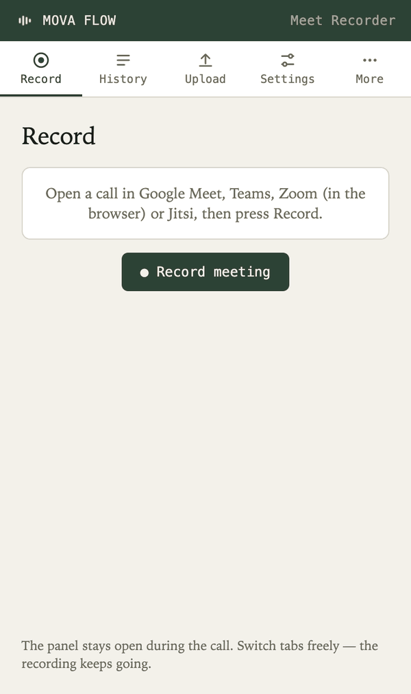

# Mova Flow Meet Recorder

A Chrome extension that records a call in Google Meet, Microsoft Teams, Zoom or Jitsi Meet — both sides of the conversation, not just what you hear — and hands it to the [Mova Flow](https://github.com/f3an/Mova-Flow) app on the same computer, which transcribes it on your own host. No cloud, nothing leaves your network.

**It needs the Mova Flow desktop app (0.4.12 or newer) running on the same computer.** The extension records; the app transcribes — itself, or through the host it's connected to (a PC with a GPU, say) — and keeps every recording in its History. The host, its secret key and the vocabulary are all set up once, in the app.

## How it works

1. On a call, press **Record** — either the button this extension adds to the call page (in Google Meet, right in its own call-controls toolbar next to mic/camera; in Zoom's web client, in its bottom bar next to More; in Microsoft Teams, first in its meeting controls; in Jitsi Meet, in its toolbox next to More actions), or the same button in the popup or side panel.
2. It captures the tab's audio (everyone else on the call) *and* your own side of the call — taken from the audio the call page itself sends to the others, **not from your microphone** (see [Where your voice comes from](#where-your-voice-comes-from)). The two stay on separate channels, so the transcript marks who said what (`Me:` / the others — on Google Meet, by name, from Meet's captions).
3. Press **Stop & transcribe**. The recording is converted to 16 kHz stereo WAV and handed to the Mova Flow app over its local bridge (`127.0.0.1:5057`). The app files it in its **History** first, then transcribes it like its own recordings.
4. The transcript comes back in the extension — copy it or download it as `.txt` — and is in the app's History too.

**The first recording on a tab takes one extra step.** Chrome only lets an extension capture a tab after the user has called on it there, and a Record button inside the page (or in the side panel) doesn't count. What does: clicking the toolbar icon *when it opens the popup* (not when it's set to open the side panel — Brave grants nothing for that click), the shortcut **⌥⇧R** / **Alt+Shift+R** (changeable at `chrome://extensions/shortcuts`), or right-clicking the call page → **Record this call with Mova Flow**. Press Record anywhere and the extension says so, lights its icon up with **REC**, and starts the moment one of those happens — no second press. The shortcut and the menu item also start or stop a recording on their own. Either way it holds until the tab navigates away.

**Nothing is lost.** If the host is down, the recording waits in the app's History as "Not transcribed" — one click on **Transcribe**, in the app or in the side panel, once it's back, caption names included. If the app itself isn't running, the recording is saved to your Downloads folder as a `.wav`, and the extension says so.

On Meet, the in-toolbar button (`src/content.ts`) targets an attribute Google's own code assigns Meet's control-bar region, since the toolbar's CSS classes are obfuscated and get reshuffled across Meet redesigns. If a redesign ever breaks it, the button just won't appear — the popup keeps working regardless, since it doesn't depend on Meet's DOM at all.

### Supported services

| Service | Where | Your side as its own channel | Speaker names |
| --- | --- | --- | --- |
| Google Meet | meet.google.com | ✓ | ✓ from Meet's captions |
| Microsoft Teams | teams.microsoft.com, teams.live.com, teams.cloud.microsoft | ✓ | — |
| Zoom | the web client only (`zoom.us/wc/…` — "Join from your browser", also inside Zoom Workplace) | ✓ from the microphone Zoom itself opened, silent while Zoom shows you muted | — |
| Jitsi Meet | meet.jit.si | ✓ | — |

Desktop apps (Zoom, Teams) are outside the browser and can't be recorded by an extension — join from the browser instead, or record with the Mova Flow app itself. Where the extension can't see the audio you send, the recording goes out as a single channel: everyone on the call, without a `Me:` split.

### Side panel (expanded mode)

<p align="center"></p>

The **⧉** button in the popup opens the whole extension in Chrome's side panel, which stays open next to the call instead of closing on the first click outside. It has five sections:

- **Record** — the same record/stop/transcript view as the popup.
- **History** — the Mova Flow app's own History, searchable, with copy, download `.txt` and delete; recordings still waiting for a transcript can be sent from here.
- **Upload** — any audio or video file the browser can decode (mp3, m4a, wav, ogg, webm, mp4…), with a language choice, transcribed by the app.
- **Settings** — whether the app is running and where it transcribes, and an option to open the side panel instead of the popup when you click the toolbar icon.
- **More** — links to the Mova Flow app, setup guide, website, Web Store review, issues and privacy policy.

## Install

**[Chrome Web Store](https://chromewebstore.google.com/detail/mova-flow-meet-recorder/kdeeohghjiengnkgfpjkakeajhnddfnh)** (works in Brave too). Or build and load it unpacked:

```bash
npm install
npm run build
```

Then in Chrome: `chrome://extensions` → enable **Developer mode** → **Load unpacked** → select this folder. An unpacked build has its own extension ID; add it to the app's `config.json` as `"trusted_extension_ids": ["<id>"]` so the app lets it read History and transcribe.

## Setup

1. Install [Mova Flow](https://github.com/f3an/Mova-Flow/releases/latest) on the same computer and set it up — as a host, or as a client of your host.
2. Keep it running (it lives in the tray / menu bar). The extension's setup page turns green once it sees the app.

That's it — there's no microphone permission to grant, and nothing to configure in the extension. The one thing your browser may ask is **access to apps on this computer** (Chrome's Local Network Access, Brave's Localhost access): the extension reaches Mova Flow at `127.0.0.1:5057`, and if that's been turned down it says so, with a link to the setting.

## Where your voice comes from

Capturing only the tab gives you what the call *plays back to you* — the other participants. It does **not** include your own voice: no call service plays you back to yourself.

Instead of opening your microphone, a small script injected into the call page (`src/callAudioHook.ts`, loaded before the page's own code) records the audio track the page **sends to the other participants** over WebRTC — after the service's own processing, and silent whenever you're muted. So the recording contains exactly what the others heard from you, and the extension never asks for, or touches, your microphone.

Zoom's web client is the exception: it sends no audio track at all — it encodes your microphone itself and ships it over a data channel — so there your side is the microphone track Zoom itself opened (still never opened by the extension). That track keeps running when you mute in Zoom, so the extension watches Zoom's mic button and silences your side for as long as it shows you muted; if it can't tell (not joined to audio yet, a Zoom redesign), your side stays silent rather than risk recording you while muted.

If a service sends audio some other way and the script can't see it at all, the recording goes out mono — the call itself is still recorded.

## Development

```bash
npm run typecheck
npm run build     # one-off bundle via esbuild
npm run watch      # rebuild on change
```

- `src/background.ts` — the service worker; finds the active tab, requests `tabCapture` permission, creates the offscreen document.
- `src/offscreen.ts` — the only place with a real DOM in Manifest V3, so the only place that can run a `MediaRecorder`/`AudioContext`. Does the actual capture, mixing, WAV conversion, and upload.
- `src/bridge.ts` — everything the extension says to the Mova Flow app: hand over a recording, follow its transcription, read History.
- `src/recordView.ts` — the record/stop view: live status (via `chrome.storage.session`, so it survives the popup closing mid-meeting) and the finished transcript. Rendered by both `src/popup.ts` and the side panel.
- `src/sidepanel.ts` — the side panel: Record, History, Upload, Settings and More.
- `src/platforms.ts` — the supported call services and how each is recognized from its URL.
- `src/content.ts` — puts the record button into the call page's own controls; reads/writes the same `chrome.storage.session` status the popup uses, so both stay in sync. Also relays your side of the call from the page to the offscreen document.
- `src/callAudioHook.ts` — runs in the call page itself (`"world": "MAIN"`) and records the audio it sends.
- `src/captions.ts` — logs who spoke when from Meet's live captions, so the host can name the other speakers.
- `src/wav.ts` — the WAV encoder, ported from the Mova Flow desktop app's own `renderer.ts`.

## Status

Tested against live Google Meet calls in Chrome and Brave; the other services share the same recording path but have had less live testing. The parts most exposed to change are the ones that read the call page itself — the button, Meet's captions, and the outgoing-audio hook; each fails soft (no button, no names, silent own side) rather than breaking the recording. If recording doesn't start, check the service worker's console at `chrome://extensions` → the extension's **service worker** link, and the offscreen document's own console (same page, under "Inspect views").

## License

[Apache License 2.0](LICENSE).
